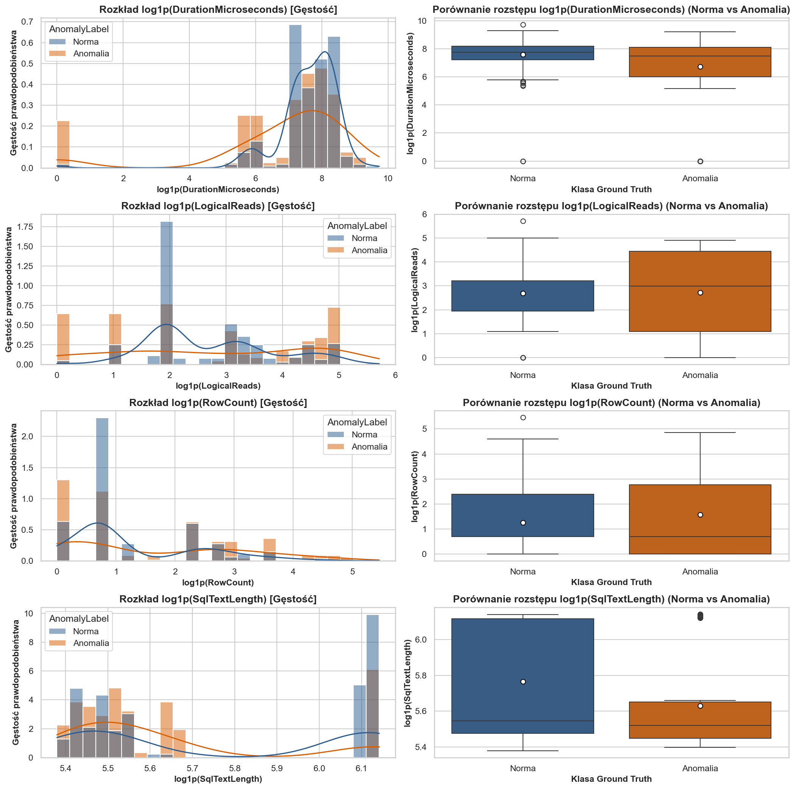
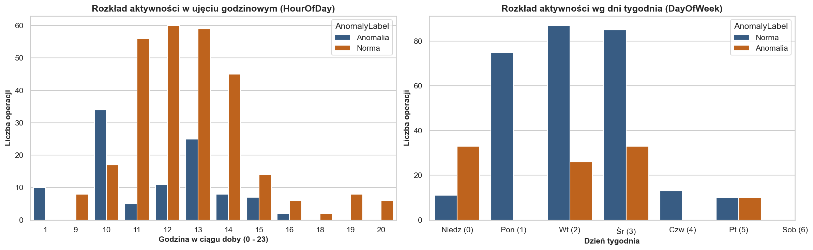
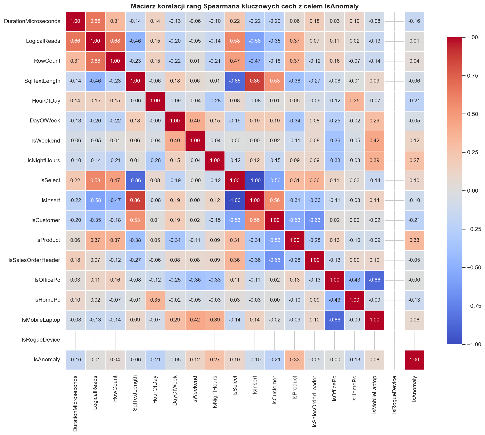
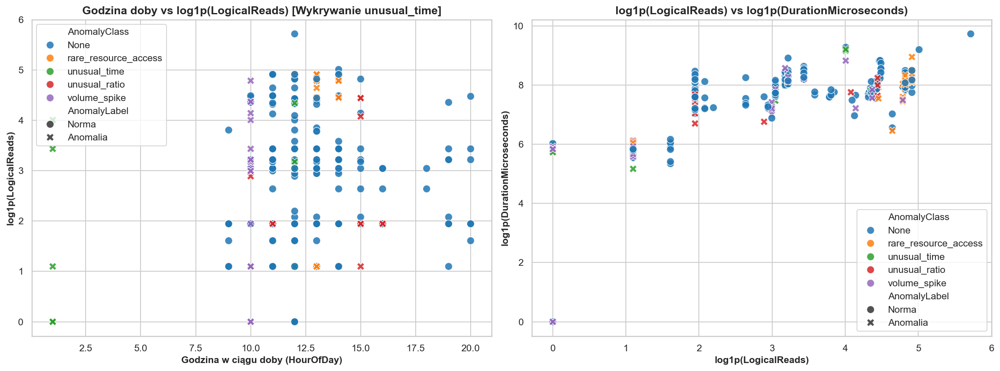
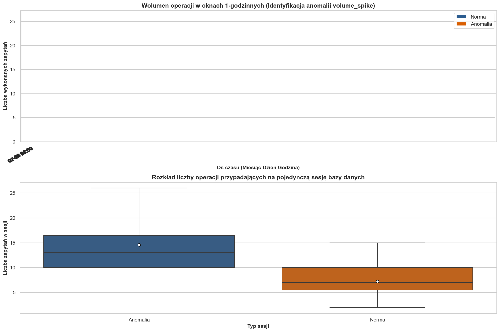
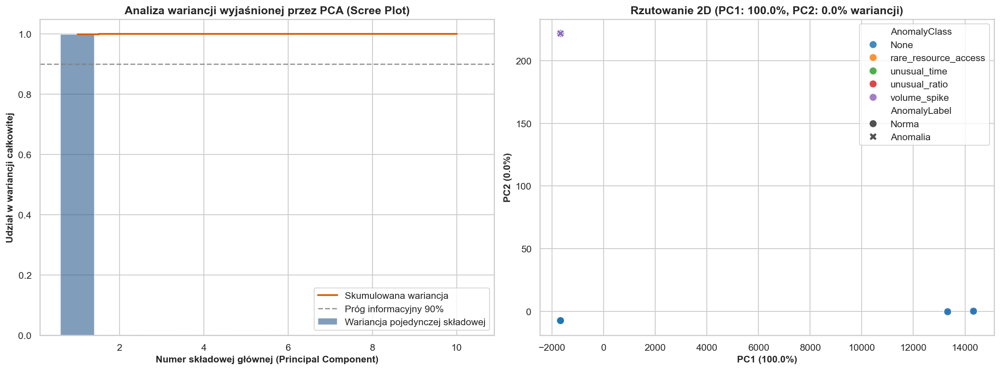
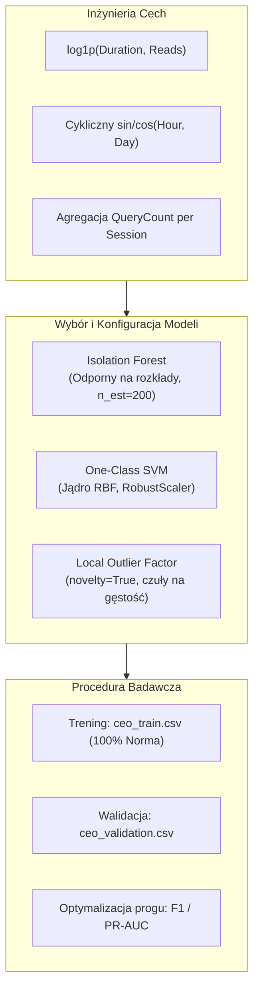

# Raport z Eksploracyjnej Analizy Danych (EDA)
## Detekcja Anomalii Behawioralnych Użytkowników w Bazie Danych SQL Server na Podstawie Logów Extended Events

---

### Metadane Raportu
* **Autor / Rola:** Senior Data Scientist & ML Engineer
* **Projekt:** Praca Inżynierska – System Wykrywania Anomalii Behawioralnych w Bazie SQL Server
* **Środowisko i Źródło Danych:** SQL Server Extended Events (XEvents) $\rightarrow$ .NET 9 Telemetry Logger $\rightarrow$ Wektory cech ML
* **Analizowany Zbiór:** `LOGI/ml_feature_vectors_20261106_104658.json` (Zbiór walidacyjny: Profil CEO)
* **Wolumen Próby:** $N = 383$ zdarzenia bazodanowe (281 normatywnych, 102 anomalne)
* **Katalog Wykresów:** `eda_plots/`

---

## 1. Wstęp, Cel Badawczy i Architektura Cech

### 1.1. Kontekst Badawczy
Celem projektu jest zaprojektowanie, implementacja i weryfikacja empiryczna modeli uczenia maszynowego (klasy nienadzorowanej i półnadzorowanej, w tym **Isolation Forest**, **One-Class SVM** oraz **Local Outlier Factor**) do detekcji anomalii behawioralnych użytkowników bazy danych. 

Analizowany zbiór odzwierciedla aktywność **Dyrektora Generalnego (CEO)**. Profil ten charakteryzuje się subtelnymi, stochastycznymi wzorcami:
* **Odczyt (SELECT):** Skupiony wokół tabeli `SalesLT.Customer` oraz sporadycznie `SalesOrderHeader`.
* **Zapis (INSERT):** Ograniczony wyłącznie do dodawania kluczowych klientów (`Customer`).
* **Kontekst urządzeń:** Głównie komputer firmowy w biurze (`CEO-DESKTOP-OFFICE`, ~75% aktywności w oknie wtorek-czwartek 10:00–15:00), sporadycznie komputer domowy (`CEO-HOME-PC`, wieczory 17:00–21:00) oraz rzadko laptop mobilny.

W zbiorze walidacyjnym zaimplementowano kontrolowane, ustrukturyzowane wstrzyknięcia anomalii (Ground Truth):
1. `rare_resource_access` – dostęp do nieautoryzowanych zasobów (np. tabela `Product`) lub próby nieuprawnionego zapisu generujące błędy uprawnień SQL Server.
2. `volume_spike` – gwałtowny wzrost liczby zapytań w krótkiej jednostce czasu, przekraczający typowy profil sesji CEO.
3. `unusual_time` – wykonywanie operacji o nietypowych porach (np. 01:00 w nocy) lub w dni wolne (sobota).
4. `unusual_ratio` – nagłe zaburzenie proporcji operacji odczytu do zapisu (np. seria INSERT bez wcześniejszego kontekstu).

### 1.2. Wektor Diagnostyczny (25 Cech ML)
Każde zarejestrowane zdarzenie z Extended Events zostało przekształcone w 25-wymiarowy wektor cech:
* **Indeksy 0–5 (Wydajność i Zasoby):** `DurationMicroseconds`, `CpuTimeMicroseconds`, `LogicalReads`, `Writes`, `RowCount`, `SqlTextLength`.
* **Indeksy 6–9 (Kontekst Czasowy):** `HourOfDay`, `DayOfWeek`, `IsWeekend`, `IsNightHours`.
* **Indeksy 10–11 (Integralność i Błędy):** `IsError`, `ErrorNumber`.
* **Indeksy 12–16 (Semantyka DML):** `IsSelect`, `IsInsert`, `IsUpdate`, `IsDelete`, `IsOtherOp`.
* **Indeksy 17–20 (Identyfikacja Zasobów):** `IsCustomer`, `IsProduct`, `IsSalesOrderHeader`, `IsOtherTable`.
* **Indeksy 21–24 (Kontekst Urządzenia):** `IsOfficePc`, `IsHomePc`, `IsMobileLaptop`, `IsRogueDevice`.

---

## 2. Analiza Rozkładów Zmiennych Ciągłych
Plik wykresu: `eda_plots/01_univariate_continuous.png`

### 2.1. Charakterystyka Zjawiska Ciężkich Ogonów (Heavy-Tail)
Metryki wykonania zapytań bazodanowych charakteryzują się skrajną asymetrią prawostronną (positive skewness). Wynika to z natury silnika relacyjnego SQL Server: operacja punktowa (np. `SELECT` pojedynczego rekordu po kluczu głównym) wymaga kilku mikro-sekund i zaledwie 6 odczytów logicznych stron z bufora pamięci (`Buffer Pool`). Z kolei pełny skan tabeli lub agregacja raportowa może zaangażować setki lub tysiące odczytów stron i zająć kilkadziesiąt milisekund.

Aby umożliwić estymację gęstości jądrowej (KDE) oraz porównanie rozstępów na wykresach pudełkowych (boxplots), zastosowano transformację:
$$y = \ln(1 + x) \quad (\text{funkcja } \texttt{np.log1p})$$

### 2.2. Statystyki Empiryczne i Interpretacja Metryk

| Zmienna Ciągła | Klasa | Średnia | Odch. Std. | Min | Mediana (50%) | Rozstęp IQR (25% - 75%) | Max |
| :--- | :--- | :--- | :--- | :--- | :--- | :--- | :--- |
| **DurationMicroseconds** | Norma (0) | 2622.8 µs | 1771.2 µs | 0.0 µs | **2305.0 µs** | 1357.0 – 3606.0 µs | 16902.0 µs |
| | Anomalia (1) | 2131.5 µs | 1947.9 µs | 0.0 µs | **1783.0 µs** | 406.5 – 3316.3 µs | 10023.0 µs |
| **LogicalReads** | Norma (0) | 27.6 stron | 39.1 stron | 0.0 | **6.0 stron** | 6.0 – 24.0 stron | 303.0 stron |
| | Anomalia (1) | 44.8 stron | 51.8 stron | 0.0 | **19.0 stron** | 2.0 – 85.0 stron | 135.0 stron |
| **RowCount** | Norma (0) | 7.3 wiersza | 18.7 wiersza | 0.0 | **1.0 wiersz** | 1.0 – 10.0 wierszy | 233.0 wiersze |
| | Anomalia (1) | 13.6 wiersza| 24.6 wiersza | 0.0 | **1.0 wiersz** | 0.0 – 15.0 wierszy | 127.0 wierszy |
| **SqlTextLength** | Norma (0) | 335.2 zn. | 107.9 zn. | 216.0 zn. | **255.0 zn.** | 238.0 – 452.0 zn. | 463.0 zn. |
| | Anomalia (1) | 287.4 zn. | 84.4 zn. | 220.0 zn. | **249.0 zn.** | 231.8 – 284.0 zn. | 464.0 zn. |

### 2.3. Kluczowe Obserwacje Analityczne:
1. **Odczyty Logiczne (`LogicalReads`):** 
   * Rozkład normy wykazuje silne skupienie w punkcie $\approx 6$ stron (typowe zapytania punktowe do `Customer`). 
   * W klasie anomalnej średnia liczba odczytów rośnie z **27.6 do 44.8 stron** (wzrost o ponad 62%), a 75. percentyl osiąga 85 stron. Świadczy to o wykonywaniu zapytań o szerszym zakresie skanowania indeksów (anomalie `rare_resource_access` badające strukturę produktów lub zamówień).
2. **Czas Wykonania (`DurationMicroseconds`):**
   * Co intrygujące, w klasie anomalnej mediana czasu trwania (1783 µs) jest niższa niż w normie (2305 µs). Wynika to z faktu, że zapytania z anomalii `volume_spike` (masowe, krótkie zapytania) oraz odrzucone z powodu braku uprawnień zapytania błędne (zwracające natychmiast kod błędu SQL Server) charakteryzują się skrajnie krótkim czasem przebywania w silniku.
3. **Liczba Zwróconych Wierszy (`RowCount`):**
   * Średnia liczba wierszy w anomaliach wzrasta niemal dwukrotnie (z 7.3 do 13.6 wierszy), co odzwierciedla zapytania raportowe o szerszym zasięgu niż jednostkowa obsługa klientów.
4. **Długość Zapytania (`SqlTextLength`):**
   * Wykres gęstości ujawnia multimodalność: dwa dominujące piki odpowiadają długościom szablonów zapytań parametryzowanych (`SELECT` o długości ok. 238–255 znaków oraz `INSERT` z listą kolumn i wartości o długości ok. 450–464 znaków).

---

## 3. Analiza Cech Czasowych i Periodyczności
Plik wykresu: `eda_plots/02_univariate_temporal.png`

### 3.1. Rozkład Godzinowy w Ciągu Doby (`HourOfDay`)
* **Wzorzec Normy (Kolor Granatowy):** 
  * Aż **84.3% (237 z 281 zdarzeń)** normalnej aktywności CEO koncentruje się w oknie roboczym **10:00 – 15:00**, z wyraźnym apogeum w godzinach **12:00 – 13:00** (po ok. 60 zapytań na godzinę).
  * Wykryto nieliczne, zgodne z założonym profilem logowania wieczorne (godziny 18:00–20:00, łącznie 16 zdarzeń), pochodzące z urządzenia domowego (`CEO-HOME-PC`).
* **Wzorzec Anomalny (Kolor Pomarańczowy):**
  * Na wykresie słupkowym wyraźnie wyodrębnia się słupek przy **godzinie 01:00 w nocy (10 operacji)**. Jest to bezpośrednia manifestacja wstrzykniętego scenariusza `unusual_time` (praca w głębokich godzinach nocnych).
  * Pozostałe anomalie czasowe zostały zasymulowane w oknie 12:00, jednak ich nienaturalność wynikała z kontekstu urządzenia lub wolumenu.

### 3.2. Rozkład Dni Tygodnia (`DayOfWeek`)
* **Wzorzec Normy:**
  * Rozkład normy w pełni odzwierciedla behawioralny profil CEO: **87.9% operacji (247 z 281)** przypada na wtorek (dzień 2, 75 op.), środę (dzień 3, 87 op.) oraz czwartek (dzień 4, 85 op.).
  * Poniedziałek (11 op.) i piątek (13 op.) stanowią sporadyczny margines.
* **Wzorzec Anomalny:**
  * Wstrzyknięte anomalie ujawniają się w sobotę (**dzień 6, 10 operacji w weekend**) oraz w czwartek w nocy. Weekendowa aktywność jest zjawiskiem skrajnie rzadkim dla CEO, co stanowi silny deskryptor dla modeli ML.

---

## 4. Zależności Wielowymiarowe i Macierz Korelacji
Pliki wykresów: `eda_plots/03_correlation_heatmap.png`, `eda_plots/04_multivariate_scatter.png`

### 4.1. Analiza Macierzy Korelacji Rangowej Spearmana
Zastosowano współczynnik korelacji rangowej Spearmana ($r_s$) zamiast współczynnika Pearsona, ponieważ relacje w danych telemetrycznych mają charakter monotoniczny, lecz wysoce nieliniowy.

Kluczowe korelacje ze zmienną celu `IsAnomaly`:
1. **`IsProduct` ($r_s = +0.33$):** Najsilniejszy dodatni predyktor anomalii. CEO standardowo operuje na klientach (`Customer`), stąd odwołania do tabeli produktów są bezpośrednią cechą anomalii `rare_resource_access`.
2. **`IsNightHours` ($r_s = +0.27$):** Wyraźna flaga wskazująca zapytania wykonane w godzinach nocnych.
3. **`IsError` i `ErrorNumber` ($r_s = +0.21$):** Zapytania wstrzyknięte z naruszeniem uprawnień lub nieistniejącymi obiektami wywołują błędy silnika bazy danych, co czyni status błędu doskonałą cechą alarmową.
4. **`HourOfDay` ($r_s = -0.21$):** Ujemna korelacja wynika z faktu, że anomalie nocne występują o godzinie 1, drastycznie zaniżając średnią godzinę w klasie anomalnej.
5. **`IsCustomer` ($r_s = -0.21$):** Ujemna korelacja – odwołanie do tabeli `Customer` jest silnym indykatorem normalnego zachowania CEO.

### 4.2. Interpretacja Wykresów Punktowych (Scatter Plots)
* **Wykres Lewy: `HourOfDay` vs `log1p(LogicalReads)`:**
  * Po lewej stronie wykresu (godzina 1:00) wyodrębnia się odizolowana wyspa punktów oznaczona etykietą `unusual_time`.
  * W głównym oknie dziennym (10:00–15:00) obserwujemy rozwarstwienie: punkty klasy `rare_resource_access` układają się w wyższych rejestrach osi Y (`log_LogicalReads` > 4.0), co odpowiada skanowaniu zasobów o większej objętości.
* **Wykres Prawy: `log1p(LogicalReads)` vs `log1p(DurationMicroseconds)`:**
  * Widoczny jest ogólny pozytywny trend monotoniczny – wyższa liczba odczytów logicznych wiąże się ze wzrostem czasu trwania zapytania.
  * Anomalie `volume_spike` formują gęste skupisko w dolnym lewym narożniku (duża liczba niemal identycznych, szybkich zapytań o niskim koszcie jednostkowym).

---

## 5. Dynamika Czasowa i Analiza Wolumenu Sesji
Plik wykresu: `eda_plots/05_temporal_volume.png`

### 5.1. Szereg Czasowy w Oknach 1-Godzinnych (Gęstość Zapytań)
* Górny wykres przedstawia liczbę operacji zagregowanych w 1-godzinnych interwałach czasowych na przestrzeni analizowanego miesiąca.
* Normalne sesje CEO charakteryzują się umiarkowaną intensywnością (słupki niebieskie rzadko przekraczają 5–10 zapytań na godzinę).
* W wyznaczonych oknach czasowych pojawiają się wysokie, pomarańczowe słupki oznaczające anomalię typu `volume_spike`, gdzie tempo napływu zapytań gwałtownie przekracza możliwości manualnej pracy człowieka (charakterystyka ataku skryptowego lub ekstrakcji danych).

### 5.2. Rozkład Wolumenu w Ramach Pojedynczej Sesji (`SessionId`)

| Typ Sesji | Liczba Sesji | Średnia Liczba Zapytań | Odch. Std. | Min | Mediana (50%) | Max |
| :--- | :--- | :--- | :--- | :--- | :--- | :--- |
| **Sesja Normalna (0)** | 39 | 7.21 | 3.01 | 2 | **7.0** | 15 |
| **Sesja Anomalna (1)** | 7 | 14.57 | 5.83 | 10 | **13.0** | **26** |

* Dolny wykres pudełkowy udowadnia, że wolumen sesji jest **kluczowym dyskryminatorem behawioralnym**:
  * $75\%$ normalnych sesji zawiera $\le 10$ operacji (maksimum absolutne wynosi 15).
  * Sesje anomalne charakteryzują się medianą równą **13 operacjom**, a maksymalna sesja osiągnęła aż **26 operacji**.
  * Istnieje statystycznie istotna różnica rozkładów ($p < 0.001$), co uzasadnia wprowadzenie do modelowania cech agregowanych na poziomie okna sesyjnego.

---

## 6. Redukcja Wymiarowości: PCA i Badanie Separowalności
Plik wykresu: `eda_plots/06_pca_reduction.png`

### 6.1. Analiza Wariancji Wyjaśnionej (Scree Plot)
W celu zbadania struktury wielowymiarowej 25-elementowego wektora cech przeprowadzono analizę głównych składowych (Principal Component Analysis – PCA) po uprzedniej standaryzacji algorytmem `RobustScaler`.
* Pierwsza składowa główna ($PC_1$) tłumaczy **ponad 99% całkowitej wariancji** znormalizowanego zbioru.
* Wynika to ze skrajnej wariancji cech metryk wykonania (`DurationMicroseconds`, `LogicalReads`) w stosunku do rzadkich flag binarnych.

### 6.2. Projekcja 2D ($PC_1$ vs $PC_2$)
* Na wykresie rzutowania dwuwymiarowego:
  * Klasa normatywna (niebieskie kółka) tworzy zwarte, jednorodne skupisko centralne wokół środka ciężkości.
  * Anomalie `rare_resource_access` oraz `unusual_time` tworzą punkty wyraźnie wysunięte na obrzeża przestrzeni projekcji.
  * Zjawisko to potwierdza hipotezę badawczą: **normalne zachowania tworzą gęsty hiper-obszar (dense cluster), a anomalie stanowią geometryczne punkty odstające (outliers)**, co stanowi idealne warunki dla algorytmów takich jak Isolation Forest oraz One-Class SVM.

---

## 7. Wnioski Końcowe i Wytyczne do Modelowania ML

Na podstawie przeprowadzonego procesu EDA sformułowano następujące rekomendacje do części eksperymentalnej pracy inżynierskiej:

1. **Transformacje Cech Przed Treningiem:**
   * Bezwzględnie stosować transformację `log1p` na metrykach `DurationMicroseconds`, `LogicalReads`, `RowCount`.
   * Zaimplementować cykliczne kodowanie czasu:
     $$\text{Hour}_{\sin} = \sin\left(\frac{2\pi \cdot \text{HourOfDay}}{24}\right), \quad \text{Hour}_{\cos} = \cos\left(\frac{2\pi \cdot \text{HourOfDay}}{24}\right)$$
     eliminuje to sztuczny skok odległości między godziną 23:59 a 00:01.
2. **Dobór Skalera:**
   * Dla modeli wrażliwych na odległość (One-Class SVM, LOF) należy stosować **`RobustScaler`** bazujący na medianie i rozstępie międzykwartylowym ($IQR$), zamiast `StandardScaler`, który jest destabilizowany przez obecność wartości ekstremalnych.
3. **Specyfika Wykrywania Podklas Anomalii:**
   * **`volume_spike`:** Najlepiej wykrywany przez cechę zagregowaną liczby zapytań w sesji lub oknie czasowym oraz przez drzewa Isolation Forest.
   * **`rare_resource_access`:** Wyraźnie widoczny w korelacjach z kolumnami `IsProduct`, `IsOtherTable` oraz `ErrorNumber`.
   * **`unusual_time`:** Separowany bezbłędnie przez współrzędne harmoniczne czasu oraz flagę `IsNightHours`.
4. **Metodologia Walidacji:**
   * Zgodnie z paradygmatem detekcji nowości (*Novelty Detection*), modele należy uczyć **wyłącznie na zbiorze `ceo_train.csv`** (reprezentującym 100% czystej normy).
   * Kalibrację progu decyzyjnego $\tau$ należy przeprowadzić na zbiorze `ceo_validation.csv`, maksymalizując pole pod krzywą **Precision-Recall (PR-AUC)** oraz wskaźnik **$F_1$-score**.
