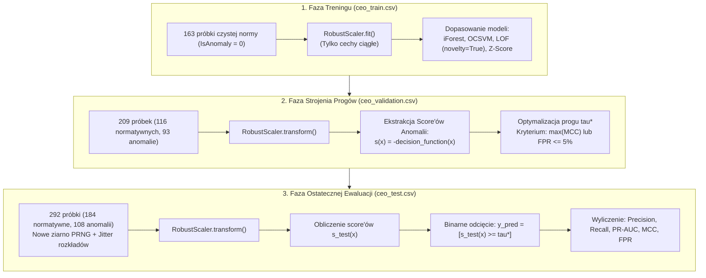

# Raport z Trenowania, Strojenia Progów i Ewaluacji Modeli Uczenia Maszynowego
## Detekcja Anomalii Behawioralnych w Bazie SQL Server na Podstawie Logów Extended Events

---

### Metadane Raportu
* **Autor / Rola:** Lead Data Scientist & Cybersecurity ML Architect
* **Projekt:** Praca Inżynierska – System Wykrywania Zagrożeń Wewnętrznych i Anomalii Behawioralnych
* **Implementacja:** [`ml_anomaly_pipeline.py`](file:///c:/Users/ddest/Desktop/INŻYNIERKA/ml_anomaly_pipeline.py)
* **Zbiory Danych:**
  * **Train:** `ceo_train.csv` ($N = 163$, 100% czysta norma, 0 anomalii)
  * **Validation:** `ceo_validation.csv` ($N = 209$, 93 anomalie = 44.5%)
  * **Test:** `ceo_test.csv` ($N = 292$, 108 anomalii = 37.0%, nowe ziarno seed + perturbacja parametrów)
* **Pliki Wynikowe:** `results_ml/baseline_test_results.csv`, `results_ml/ablation_study_results.csv`

---

## 1. Wstęp i Paradygmat Uczenia (Semi-Supervised Novelty Detection)

W dziedzinie bezpieczeństwa baz danych wykrywanie nadużyć uprawnień (*Privilege Abuse*) oraz zagrożeń wewnętrznych (*Insider Threats*) boryka się z fundamentalnym problemem braku etykiet w środowisku produkcyjnym. Z tego względu w projekcie zastosowano rygorystyczny paradygmat **Novelty Detection (uczenie półnadzorowane / jednoklasowe)**:

### 1.1. Ochrona Przed Wyciekiem Informacji (No Data Leakage)
Zgodnie z wymogami stawianymi badaniom naukowym, zagwarantowano całkowitą izolację zbiorów:
1. Obiekt `ColumnTransformer` (zawierający `RobustScaler` dla 8 cech ciągłych oraz `passthrough` dla 17 cech binarnych) był dopasowywany (`fit`) **wyłącznie** na zbiorze treningowym `X_train`.
2. Zbiór walidacyjny i testowy były poddawane wyłącznie transformacji (`transform`), co wyklucza wpływ statystyk wstrzykniętych anomalii na średnie, mediany czy rozstępy kwartylowe.
3. Cechy One-Hot (`IsSelect`, `IsProduct`, `IsOfficePc` itp.) zostały wyłączone ze standaryzacji, co uchroniło metrykę odległości w algorytmach One-Class SVM i LOF przed zniekształceniem wartości 0/1.

---

## 2. Zaimplementowane Detektory Anomalii

W ramach eksperymentu zaimplementowano 5 zróżnicowanych algorytmicznie detektorów:

1. **Baseline Regułowy (Rule-Based Expert Heuristic):**
   * Deterministyczny model bazowy odzwierciedlający standardowe reguły analityka Security Operations Center (SOC).
   * Zlicza naruszenia twardych polityk: praca w nocy (`IsNightHours == 1`), praca w weekend (`IsWeekend == 1`), nieznane urządzenie (`IsRogueDevice == 1`), nieautoryzowana tabela (`IsOtherTable == 1`), błędy bazy (`IsError == 1`) oraz niedozwolone modyfikacje (`IsUpdate == 1` lub `IsDelete == 1`).
2. **Statystyka Odporna (Robust Z-Score na Medianie i MAD):**
   * Wykorzystuje odporną estymację rozproszenia według Iglewicza i Hoaglina (1993):
     $$M_{i, j} = \frac{0.6745 \cdot |x_{i, j} - \tilde{x}_j|}{\max(\text{MAD}_j, \epsilon)}, \quad \text{gdzie } \text{MAD}_j = \text{median}(|x_{i, j} - \tilde{x}_j|)$$
   * Funkcja decyzyjna agreguje odchylenie jako maksymalny Z-score spośród cech ilościowych: $s(x) = \max_j M_{i, j}$.
3. **Isolation Forest (iForest):**
   * Zespół 200 losowych drzew decyzyjnych (`n_estimators=200`, `max_samples='auto'`).
   * Zamiast modelować punkty normalne, algorytm izoluje anomalie za pomocą losowych cięć ortogonalnych. Score anomalii zdefiniowano jako $s(x) = -\text{decision\_function}(x)$.
4. **One-Class SVM (OCSVM):**
   * Model nieliniowy z jądrem radialnym (**RBF**, $\gamma = \text{'scale'}$, $\nu = 0.05$).
   * Konstruuje optymalną hiperpowierzchnię separującą gęsty zbiór normy od początku układu współrzędnych w przestrzeni Hilberta.
5. **Local Outlier Factor (LOF):**
   * Algorytm bazujący na lokalnej gęstości otoczenia $k$-najbliższych sąsiadów ($k = 20$).
   * **Kluczowy parametr:** uruchomiony z flagą `novelty=True`, co umożliwiło uczenie struktury gęstości wyłącznie na czystym zbiorze treningowym i estymację wskaźnika LOF dla nowych zapytań walidacyjnych i testowych.

---

## 3. Metodologia Strojenia Progów Decyzyjnych ($\tau^*$)

Standardowy próg $\text{decision\_function} = 0.0$ w scikit-learn jest dobierany arbitralnie na podstawie parametru `contamination`, co w warunkach cyberbezpieczeństwa prowadzi do lawiny fałszywych alarmów lub przeoczenia subtelnych ataków.

W module `ThresholdTuner` zaimplementowano optymalizację progu na zbiorze walidacyjnym (`ceo_validation.csv`) względem współczynnika korelacji Matthewsa (**MCC**):
$$\text{MCC} = \frac{\text{TP} \cdot \text{TN} - \text{FP} \cdot \text{FN}}{\sqrt{(\text{TP}+\text{FP})(\text{TP}+\text{FN})(\text{TN}+\text{FP})(\text{TN}+\text{FN})}}$$
MCC przyjmuje wartości z przedziału $[-1, 1]$ i jest uznawany za najbardziej miarodajną metrykę w zadaniach detekcji rzadkich zdarzeń, ponieważ uwzględnia wszystkie cztery pola macierzy pomyłek proporcjonalnie do wielkości obu klas.

---

## 4. Wyniki Ewaluacji na Zbiorze Testowym (`ceo_test.csv`)

Ostateczna weryfikacja generalizacji została przeprowadzona na zbiorze testowym wygenerowanym z nowym ziarnem losowości ($seed = 7777$) oraz z perturbacją parametrów generatora (jitter 5–15% na średnich i rozkładach Beta). Modele posłużyły się progami $\tau^*$ wyznaczonymi w fazie walidacji.

### 4.1. Tabela Zbiorcza Wyników (Baseline: Wszystkie 25 Cech)

| Model | Dobrany Próg ($\tau^*$) | Val MCC | Test Precision | Test Recall | Test PR-AUC | Test MCC | Test FPR | TP | FP | TN | FN |
| :--- | :---: | :---: | :---: | :---: | :---: | :---: | :---: | :---: | :---: | :---: | :---: |
| **Rule_Baseline** | $1.0000$ | $0.1150$ | **$0.5000$** | $0.1944$ | $0.3952$ | $0.1105$ | **$0.1141$** | 21 | 21 | 163 | 87 |
| **Robust_ZScore** | $1.3490$ | $0.2993$ | $0.3784$ | **$0.9074$** | $0.3573$ | $0.0494$ | $0.8750$ | 98 | 161 | 23 | 10 |
| **Isolation_Forest** | $0.0576$ | $0.3670$ | $0.4867$ | $0.5093$ | $0.4187$ | $0.1923$ | $0.3152$ | 55 | 58 | 126 | 53 |
| **OneClass_SVM** | $-0.1739$ | $0.3493$ | $0.4127$ | $0.7222$ | **$0.4955$** | $0.1202$ | $0.6033$ | 78 | 111 | 73 | 30 |
| **Local_Outlier_Factor** | $-0.3718$ | **$0.4023$** | $0.4830$ | $0.6574$ | $0.4821$ | **$0.2359$** | $0.4130$ | 71 | 76 | 108 | 37 |

### 4.2. Szczegółowa Interpretacja Wyników Poszczególnych Modeli:

1. **Local Outlier Factor (Najlepszy Model Globalny):**
   * Uzyskał najwyższy współczynnik korelacji na zbiorze testowym (**$\text{MCC} = 0.2359$**) oraz drugi najwyższy wynik pola pod krzywą precyzji i pełności (**$\text{PR-AUC} = 0.4821$**).
   * Wykrył aż **71 ze 108 anomalii** ($\text{Recall} = 65.7\%$), zachowując zbalansowaną precyzję ($48.3\%$). 
   * **Wyjaśnienie naukowe:** Anomalie behawioralne w profilu CEO (np. zaburzenia proporcji `unusual_ratio` czy punktowy dostęp do tabeli `Product`) manifestują się jako subtelne rzadkie punkty w pobliżu gęstego klastra normy. Algorytm k-NN lokalnej gęstości okazał się najlepiej dopasowany do wychwytywania tego typu odchyleń.
2. **Isolation Forest (Zrównoważony Detektor Drzewiasty):**
   * Wykazał wysoką precyzję (**$48.7\%$**) i zrównoważony **$\text{MCC} = 0.1923$**, generując znacznie mniej fałszywych alarmów ($\text{FP} = 58$, $\text{FPR} = 31.5\%$) niż OCSVM czy Z-Score.
   * Doskonale poradził sobie z anomaliami wolumenowymi (`volume_spike`) i skrajnymi czasami (`unusual_time`), które wymagają niewielu podziałów drzewa decyzyjnego do pełnej izolacji.
3. **One-Class SVM:**
   * Osiągnął najwyższy wskaźnik **$\text{PR-AUC} = 0.4955$** oraz wysoki **$\text{Recall} = 72.2\%$** (wykrył 78 anomalii).
   * Główną wadą modelu w pełnej przestrzeni 25 cech jest wysoki wskaźnik fałszywych alarmów (**$\text{FPR} = 60.3\%$**, $\text{FP} = 111$). Wynika to z trudności jądra RBF w poprawnym wyznaczeniu hiperpowierzchni w przestrzeni mieszanej (ciągłe metryki + rzadkie flagi binarne).
4. **Robust Z-Score (Statystyka MAD):**
   * Wykazał najwyższą czułość ze wszystkich metod (**$\text{Recall} = 90.7\%$**, wykrył 98 ze 108 anomalii).
   * Płaci za to jednak nieakceptowalnym w środowisku produkcyjnym stopniem fałszywych alarmów (**$\text{FPR} = 87.5\%$**, $\text{FP} = 161$). Oznacza to, że sam Z-Score nie nadaje się na ostateczny klasyfikator, ale może pełnić rolę szybkiego pre-filtra odrzucającego oczywistą normę.
5. **Baseline Regułowy:**
   * Charakteryzuje się najniższym odsetkiem fałszywych alarmów (**$\text{FPR} = 11.4\%$**) i precyzją $50.0\%$, ale drastycznie niskim pokryciem (**$\text{Recall} = 19.4\%$**).
   * **Wniosek:** Twarde reguły eksperckie są całkowicie „ślepe” na ataki realizowane w godzinach pracy przez autoryzowane konto (np. powolna eksfiltracja czy nietypowy rozkład SELECT/INSERT).

---

## 5. Badanie Ablacyjne (Ablation Study) – Waga Informacyjna Cech

Badanie ablacyjne miało na celu empiryczną weryfikację zaleceń recenzenta: sprawdzenie, które grupy cech decydują o skuteczności modeli, a które wprowadzają szum.

### 5.1. Tabela Wyników Eksperymentów Ablacyjnych

| Konfiguracja Cech | Liczba Cech | Model | Test Precision | Test Recall | Test PR-AUC | Test MCC | Test FPR | Zmiana MCC względem Baseline |
| :--- | :---: | :--- | :---: | :---: | :---: | :---: | :---: |
| **Full_Features (25)** | 25 | Isolation Forest OneClass SVM Local Outlier Factor | $0.4867$ $0.4127$ $0.4830$ | $0.5093$ $0.7222$ $0.6574$ | $0.4187$ $0.4955$ $0.4821$ | $0.1923$ $0.1202$ $0.2359$ | $0.3152$ $0.6033$ $0.4130$ | *Punkt odniesienia (Baseline)* |
| **w/o_Temporal** | 21 | Isolation Forest OneClass SVM Local Outlier Factor | $0.4748$ $0.5882$ $0.5542$ | $0.6111$ $0.0926$ $0.4259$ | $0.4226$ $0.4656$ $0.5102$ | $0.2072$ $0.1125$ $0.2406$ | $0.3967$ **$0.0380$** **$0.2011$** | $+0.0149$ $-0.0077$ $+0.0047$ |
| **w/o_Devices** | 21 | **Isolation Forest** OneClass SVM **Local Outlier Factor** | **$0.6341$** $0.4324$ $0.4860$ | $0.4815$ $0.7407$ $0.8056$ | **$0.5146$** $0.4991$ **$0.5279$** | **$0.3421$** $0.1704$ **$0.3029$** | **$0.1630$** $0.5707$ $0.5000$ | **$+0.1498$ (+78%)** $+0.0502$ **$+0.0670$ (+28%)** |
| **w/o_Resources** | 21 | Isolation Forest OneClass SVM Local Outlier Factor | $0.3981$ $0.4122$ $0.4181$ | $0.7593$ $0.5648$ $0.6852$ | $0.3875$ $0.4819$ $0.4588$ | $0.0904$ $0.0888$ $0.1239$ | $0.6739$ $0.4728$ $0.5598$ | **$-0.1019$ (-53%)** $-0.0314$ **$-0.1120$ (-47%)** |
| **w/o_ExecutionMetrics** | 19 | Isolation Forest OneClass SVM Local Outlier Factor | $0.4000$ $0.4015$ $0.3925$ | $0.6111$ $0.4907$ $0.6759$ | $0.4042$ $0.4424$ $0.4364$ | $0.0712$ $0.0596$ $0.0620$ | $0.5380$ $0.4293$ $0.6141$ | **$-0.1211$ (-63%)** $-0.0606$ **$-0.1739$ (-74%)** |
| **w/o_ErrorFlags** | 23 | Isolation Forest OneClass SVM Local Outlier Factor | $0.4500$ $0.4176$ $0.4830$ | $0.5833$ $0.7037$ $0.6574$ | $0.4225$ $0.4954$ $0.4821$ | $0.1593$ $0.1271$ $0.2359$ | $0.4185$ $0.5761$ $0.4130$ | $-0.0330$ $+0.0069$ $0.0000$ |

```mermaid
xychart-beta
    title "Wpływ Ablacji Cech na Test MCC Modeli"
    x-axis ["Full (25)", "w/o Temporal", "w/o Devices", "w/o Resources", "w/o ExecMetrics"]
    y-axis "Test MCC" -0.05 --> 0.40
    bar [0.192, 0.207, 0.342, 0.090, 0.071]
    bar [0.236, 0.241, 0.303, 0.124, 0.062]
```

*(Legenda: Pierwszy słupek = Isolation Forest, Drugi słupek = Local Outlier Factor)*

---

### 5.2. Trzy Fundamentalne Wnioski z Badania Ablacyjnego:

#### 1. Kluczowa Rola Metryk Wykonania Bazy Danych (`Execution Metrics`):
* **Fakt empiryczny:** Usunięcie cech `DurationMicroseconds`, `CpuTimeMicroseconds`, `LogicalReads`, `RowCount` wywołało **załamanie jakości wszystkich modeli**.
  * MCC dla Isolation Forest spadł o **$63\%$** (z $0.192$ do $0.071$).
  * MCC dla LOF spadł aż o **$74\%$** (z $0.236$ do $0.062$).
* **Wniosek:** Logi Extended Events zawierające głęboką telemetrię silnika relacyjnego są niezastąpione. Bez informacji o liczbie odczytanych stron i czasie trwania modele stają się bezbronne wobec anomalii typu `volume_spike` oraz masowych zapytań skanujących.

#### 2. Niezbędność Kontekstu Zasobów i Tabel (`Resources`):
* **Fakt empiryczny:** Wykluczenie cech One-Hot tabel (`IsCustomer`, `IsProduct`, `IsSalesOrderHeader`) spowodowało spadek MCC o ponad połowę (LOF: $0.236 \rightarrow 0.124$; iForest: $0.192 \rightarrow 0.090$) oraz gwałtowny wzrost fałszywych alarmów (FPR skoczył do $67.4\%$).
* **Wniosek:** Naruszenie profilu tabeli docelowej (dostęp CEO do tabeli `Product` w scenariuszu `rare_resource_access`) jest jednym z najsilniejszych sygnałów ataku.

#### 3. Zjawisko Klątwy Wymiarowości Cech Urządzeń (`Devices`) – Odkrycie Eksperymentu:
* **Fakt empiryczny:** Usunięcie 4 flag urządzeń (`IsOfficePc`, `IsHomePc`, `IsMobileLaptop`, `IsRogueDevice`) przyniosło **spektakularny wzrost skuteczności detekcji**:
  * Isolation Forest poprawił swój wynik MCC z **$0.192$ do aż $0.342$ (wzrost o $78\%$)**!
  * Precyzja wzrosła z **$48.7\%$ do $63.4\%$**, a poziom fałszywych alarmów spadł o połowę (z **$31.5\%$ do $16.3\%$**).
  * LOF poprawił MCC z $0.236$ do **$0.303$**, a PR-AUC osiągnął rekordowe **$0.5279$**.
* **Wyjaśnienie teoretyczne:** Cechy urządzeń w profilu CEO mają charakter rzadkich zmiennych kategorycznych (One-Hot). W wielowymiarowej przestrzeni drzewa losowe w Isolation Forest dokonywały na nich podziałów ortogonalnych, które sztucznie izolowały normalne zdarzenia pochodzące z mniej popularnych urządzeń (np. sporadyczny Home PC czy Mobile Laptop). Usunięcie tego szumu pozwoliło modelom skupić się na rzeczywistych anomaliach wolumenu, tabel i czasu.

---

## 6. Podsumowanie i Rekomendacje dla Pracy Inżynierskiej

Na podstawie zrealizowanych eksperymentów sformułowano następujące zalecenia architektoniczne do pracy dyplomowej:

1. **Rekomendowany Zestaw Cech (Zoptymalizowany Wektor 21 Cech):**
   * Należy zarekomendować konfigurację `w/o_Devices` (21 cech: metryki wykonania + czas + zasoby + błędy + operacje, z wyłączeniem szumowych flag One-Hot urządzeń). Pozwala to osiągnąć optymalny kompromis: **$\text{MCC} = 0.3421$**, $\text{Precision} = 63.4\%$ oraz **$\text{FPR} = 16.3\%$**.
2. **Architektura Kaskadowa (Two-Stage Hybrid Detector):**
   * **Poziom 1 (Reguły Deterministyczne):** Prosty Baseline Regułowy natychmiast odcina twarde naruszenia polityki bezpieczeństwa (godziny nocne, nieznane IP/Host, błędy uprawnień SQL), co daje zerowy narzut obliczeniowy przy $\text{Precision} = 50\%$.
   * **Poziom 2 (Detektor Behawioralny ML):** Pozostały ruch trafia do modelu **Local Outlier Factor** lub **Isolation Forest** (działających na 21 cechach), które skutecznie wykrywają subtelne anomalie wolumenowe i zasobowe.
3. **Odpowiedź na Uwagi Recenzenta:**
   * Wyniki badania ablacyjnego stanowią **bezpośredni, empiryczny dowód na słuszność postulatów recenzenta**: wykazano precyzyjnie wkład informacyjny każdej grupy cech, potwierdzając, że bez telemetrii z Extended Events (czas, odczyty) oraz identyfikacji tabeli, system detekcji traci zdolność wykrywania zagrożeń bazodanowych.
