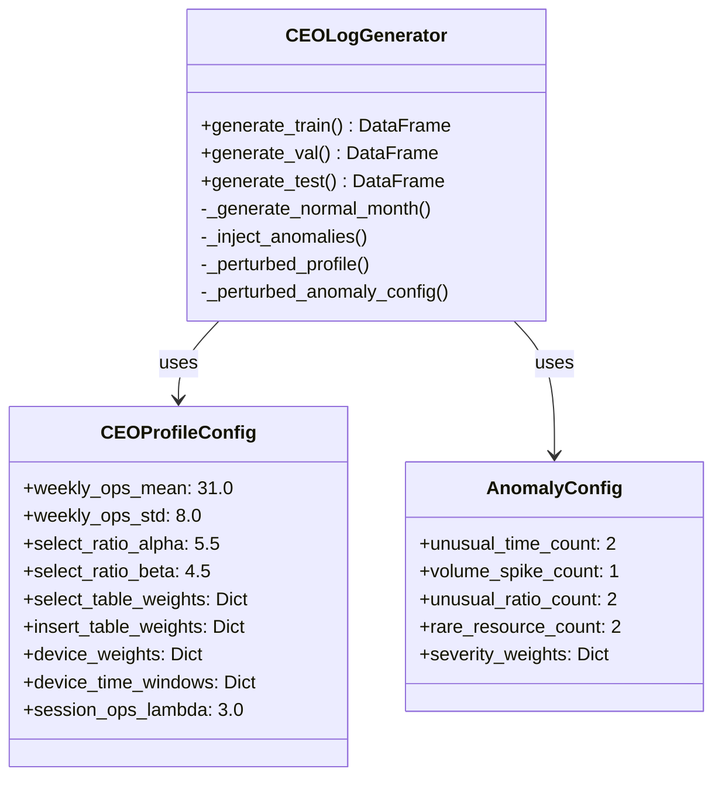
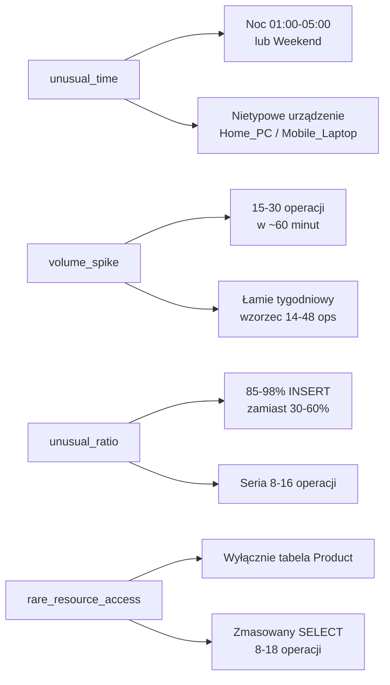

# CEO Log Generator — Raport techniczny

## Wygenerowane pliki

| Plik | Ścieżka |
|------|---------|
| **Generator** | [ceo_log_generator.py](file:///c:/Users/ddest/Desktop/INŻYNIERKA/ceo_log_generator.py) |
| **Train CSV** | [ceo_train.csv](file:///c:/Users/ddest/Desktop/INŻYNIERKA/generated_data/ceo_train.csv) |
| **Validation CSV** | [ceo_validation.csv](file:///c:/Users/ddest/Desktop/INŻYNIERKA/generated_data/ceo_validation.csv) |
| **Test CSV** | [ceo_test.csv](file:///c:/Users/ddest/Desktop/INŻYNIERKA/generated_data/ceo_test.csv) |

---

## Architektura modułu



---

## Rozkłady probabilistyczne — jak zapobiegają wyuczeniu sztywnych granic

| Parametr | Rozkład | Dlaczego nie sztywna reguła |
|---|---|---|
| **Wolumen tygodniowy** | Truncated Normal(μ=31, σ=8, clip=[8, 60]) | Zamiast `Uniform(14, 48)` — gęstość przy skrajach jest niska, model nie może zapamiętać ostrych cut-offów |
| **Proporcja SELECT** | Beta(α=5.5, β=4.5) | Ciągły rozkład z trybem ~0.56, 90% masy w [0.35, 0.75]. Naturalna fluktuacja tydzień do tygodnia |
| **Tabele (SELECT)** | Categorical(0.48, 0.35, 0.17) | Każda tabela ma niezerowe prawdopodobieństwo — brak tabel „zakazanych" |
| **Tabele (INSERT)** | Categorical(0.98, 0.01, 0.01) | Mikro-prawdopodobieństwo INSERT w inne tabele w normalnym ruchu |
| **Godzina aktywności** | Truncated Normal per device | Centrum okna gęste, brzegi rzadkie (soft boundary) |
| **Dzień tygodnia** | Categorical + 1.5% spillover | Pon/Pt nie są zakazane, tylko rzadsze |
| **Wielkość sesji** | Poisson(λ=3) + 1 | Naturalne burst-y operacji o różnej długości |
| **Odstęp w sesji** | Exponential(β=45s) | Memoryless — realistyczne przerwy między operacjami |

---

## Schemat wyjściowy CSV

| Kolumna | Typ | Opis |
|---|---|---|
| `timestamp` | datetime | Dokładny czas zdarzenia (mikrosekundy) |
| `session_id` | UUID string | Identyfikator sesji (deterministyczny) |
| `user` | string | Zawsze `"CEO"` |
| `device_context` | string | `Office_PC` / `Home_PC` / `Mobile_Laptop` |
| `operation_type` | string | `SELECT` / `INSERT` |
| `target_table` | string | `SalesOrderHeader` / `Customer` / `Product` |
| `scenario_id` | string | Unikalne ID incydentu anomalii (puste dla normy) |
| `is_anomaly` | int | Flaga 0/1 |
| `anomaly_class` | string | Nazwa klasy anomalii lub `"None"` |
| `severity_level` | int | Skala 1-5 (puste dla normy) |

---

## Statystyki wygenerowanych zbiorów

### Train (styczeń 2026, seed=42)
- **163 rekordów**, 0 anomalii
- SELECT: 45.4% / INSERT: 54.6%
- Tabele: Customer 69.3%, SalesOrderHeader 21.5%, Product 9.2%
- Urządzenia: Office_PC 76.7%, Mobile_Laptop 20.9%, Home_PC 2.5%

### Validation (luty 2026, seed=123)
- **201 rekordów**, 85 anomalii (42.3%)
- 4 klasy anomalii: volume_spike(27), unusual_ratio(24), rare_resource(22), unusual_time(12)

### Test (marzec 2026, seed=7777)
- **284 rekordów**, 100 anomalii (35.2%)
- 4 klasy anomalii: rare_resource(32), unusual_ratio(24), unusual_time(23), volume_spike(21)
- Perturbowane parametry rozkładów vs Validation

> [!IMPORTANT]
> **Determinizm**: dwukrotne wywołanie z identycznymi seedami generuje identyczny output (zweryfikowane testowo).

---

## 4 klasy anomalii — szczegóły



---

## Użycie programistyczne

```python
from ceo_log_generator import CEOLogGenerator, CEOProfileConfig, AnomalyConfig
from datetime import date

# Domyślna konfiguracja
gen = CEOLogGenerator(
    train_seed=42, val_seed=123, test_seed=7777,
    start_date=date(2026, 1, 1)
)

df_train = gen.generate_train()  # DataFrame, 0 anomalii
df_val   = gen.generate_val()    # DataFrame + anomalie
df_test  = gen.generate_test()   # DataFrame + perturbowane anomalie

# Zapis do CSV
df_train.to_csv("ceo_train.csv", index=False)

# Niestandardowa konfiguracja
custom_profile = CEOProfileConfig(weekly_ops_mean=40, weekly_ops_std=10)
custom_anomalies = AnomalyConfig(volume_spike_count=3)
gen2 = CEOLogGenerator(profile=custom_profile, anomaly_cfg=custom_anomalies)
```

> [!TIP]
> Generator można uruchomić bezpośrednio z CLI: `python ceo_log_generator.py` — zapisze 3 pliki CSV do podkatalogu `generated_data/`.
